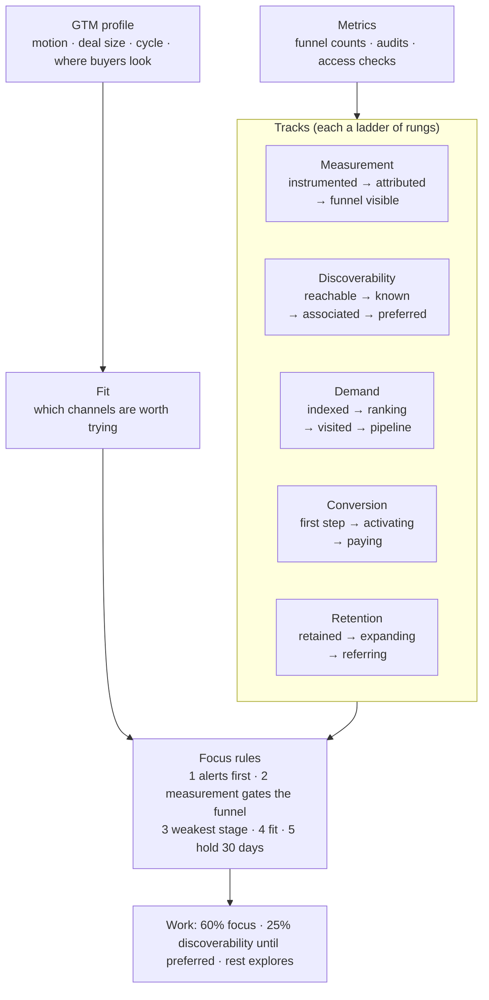
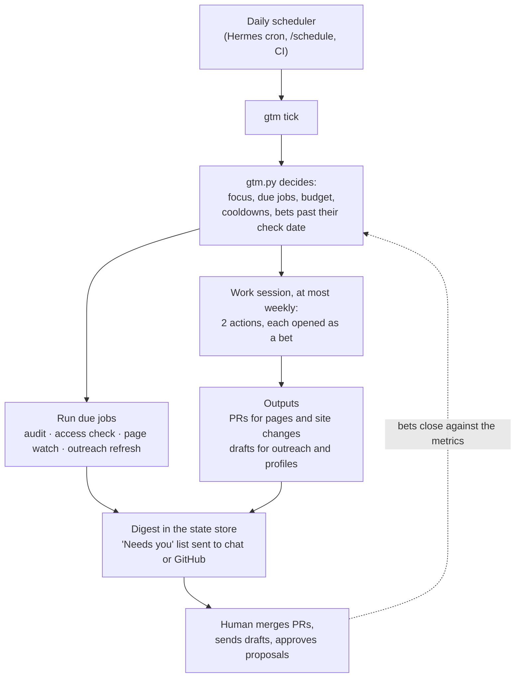

# marketing — growth skills for coding agents

A Claude Code plugin for marketing done from inside the product repo, by an agent that can read
the code. It runs as a growth operator: it measures the funnel, picks the part that's holding growth
back, and works on it with skills that ship PRs and drafts for a human to approve. The deepest
track today is **agent discoverability**: getting a product found, read, cited and recommended by AI
answer engines (ChatGPT, Perplexity, Google AI Overviews and AI Mode, Gemini, Claude, Copilot) and
the agents built on them.

## Start here: `gtm`

`/marketing:gtm` is the single entry point. Run it once in a product repo (`init`), then let a
daily scheduler call it (`tick`).

### Tracks and focus: where the product is stuck

Growth work is split into tracks, each a ladder of rungs tested against data. `gtm.py` checks every
track on each tick and picks one **focus**: the track whose weakest funnel stage holds growth back,
filtered by what fits the product and who buys it.



A paid track (tracked → profitable → scaling) exists and is off until a human turns it on.
Discoverability is a standing priority: buyers in every sales motion now shortlist with AI
assistants, so it keeps a share of the work until it reaches `preferred`.

### What one scheduled run does



Every improvement is a **bet** with a metric, a baseline, an expected value and a check date. When
the check date comes, `gtm.py bet close` judges it from the recorded metrics, and results feed back
into which tactics get tried next. A result becomes a learning only after a human accepts it.

| skill | what it does | treg spend |
|---|---|---|
| `gtm` | Entry point and operator: init (incl. pre-launch), daily tick, launch, status; focus, fit, bets, budget, digest | ~$8-12/month at defaults |
| `product-context` | The GTM profile (sales motion, deal size, buyers, cycle) plus positioning, objections, customer language, voice and accepted learnings; every skill reads it | free |
| `writing` | The gates every draft passes: claims from the ledger, an information-gain test, no AI-tell phrasing | free |
| `ai-visibility-audit` | Runs a fixed prompt panel across 5 engines, scores mention, citation, share of voice and gaps, diffs against the last run | ~$0.02 per prompt across all engines |
| `ai-search-optimization` | Bot access (robots.txt + CDN), llms.txt, feeds, quick answers, JSON-LD, IndexNow, AI-referral tracking; verifies against production | ~free |
| `one-pager` | Claims ledger from the code, intent mining, engine recon, evidence, draft, review gates, ship, track | ~$0.05-0.30 per page |
| `citation-outreach` | Ranks the exact third-party URLs engines cite when you lose, triages them, finds verified contacts, drafts honest pitches/replies for a human to send, watches for the mention | <$0.50 per 30 targets |
| `entity-presence` | Canonical entity card, trained-knowledge vs retrieval probe, profile inventory (Wikidata, directories, stores, GitHub), paste-ready fixes, sameAs wiring | ~$0.15 per probe |
| `comparison-pages` | Sourced competitor dossiers, a fairness-gated comparison grid, vs/alternatives/switching pages via `one-pager`, competitor-change watcher | ~$0.05-0.10 per page |

### Where the data lives

The product repo only receives PRs. The program's memory (config, metrics, bets, audit runs,
digests, drafts) lives in a **state store** outside it: `~/.marketing/<owner>-<repo>/` on the
agent's machine by default, or a private git repo for hosts that don't keep files between runs.
`gtm.py where` prints the location. Installs from 0.3 that kept `.marketing/` in the repo keep
working and can move with `gtm.py migrate --to <dir or git URL>`. Later phases add PostHog as the
team's dashboard for funnel and marketing metrics.

## Install

### Prerequisites

- **[treg](https://treg.to)**: the skills get their live data (AI engine answers, search results,
  keywords, forums, page reads) through it. Install the CLI and sign in:
  `curl -fsSL https://treg.to/install.sh | sh`, then follow https://treg.to/llms.txt. Paid calls
  draw on a prepaid team balance; a typical month at `gtm` defaults is about $8-12. Without treg,
  the skills fall back to plain web search and skip measurement, and they say so.
- **`python3`** (3.9 or newer). The scripts use only the standard library; nothing to `pip install`.
- **`gh`**, signed in, if you want `gtm` to open PRs.

### Claude Code

```
/plugin marketplace add williampsmith/marketing-skills
/plugin install marketing@marketing-skills
```

Skills are invoked as `/marketing:<skill>` (start with `/marketing:gtm`), or picked up
automatically from their descriptions. Update later with `/plugin marketplace update marketing-skills`.

### Other agents (Hermes, Codex, Cursor, …)

The skills are plain Agent Skills folders (`SKILL.md` plus scripts), so any agent that reads them
can use them. Clone the repo and link the skills into the agent's skills directory, keeping them
side by side (skills call siblings' scripts through `../<skill>/scripts/`):

```bash
git clone https://github.com/williampsmith/marketing-skills.git
ln -s "$PWD"/marketing-skills/skills/* ~/.hermes/skills/    # or that agent's skills directory
```

A `git pull` in the clone updates them. Scheduling uses the agent's own scheduler; see
`skills/gtm/references/hosts.md`.

### Running it unattended on a server

[`docs/remote-setup.md`](docs/remote-setup.md) is the playbook for both Claude Code (cloud routine or
your own server) and Hermes Agent: credentials with least privilege, where the state store lives,
the supervised `init`, the daily heartbeat, the first week, and day-to-day operation.

## Why built this way

- **Measure first.** Every change is a bet judged against recorded metrics, so "it worked" is a
  number, not a feeling.
- **Decide in code.** Dates, money, fit, focus, cooldowns and bet results come from `gtm.py`, so every
  run on every host agrees on the facts.
- **Fit before effort.** The product's sales motion and buyers decide which channels are worth
  trying; the product's own results then overrule the defaults.
- **Claims come from code.** Marketing copy written by an agent that can read the code should never
  claim something the code doesn't do. The claims ledger enforces that and keeps you on the right
  side of claim-substantiation rules.
- **Thought leadership over pitch.** Answer pages win citations by being the best answer to the
  question; the product shows up in a separate, honest section at the end.
- **Humans publish.** The agent opens PRs and writes drafts. Sending authority is earned per channel.
- **treg as the data layer.** Ask for the job, not a vendor, check the price before spending, and
  prefer routed endpoints with cost ceilings. Endpoint ids in these docs are dated examples, and the
  skills tell the agent to re-discover them.

## Develop

```
python3 -m unittest discover tests        # script tests (stdlib only)
```

See `CLAUDE.md` for conventions, `docs/design/growth-operator.md` for the design, and
`docs/skill-ideas.md` for the backlog.

## License

MIT. See `LICENSE`.
