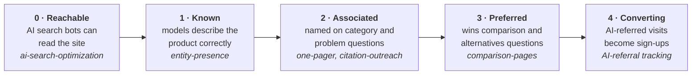
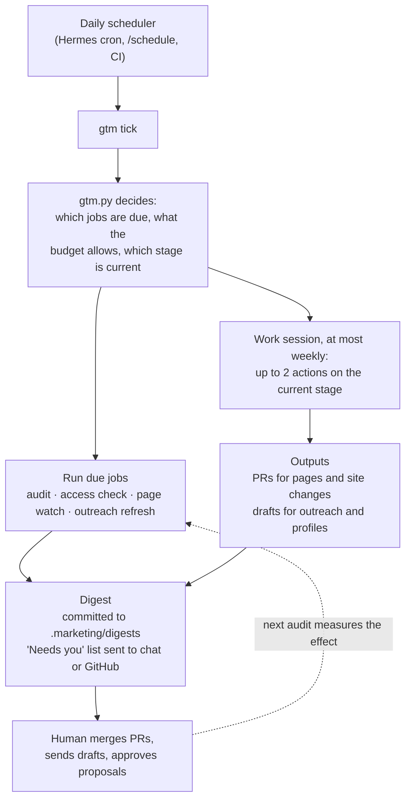

# marketing — growth skills for coding agents

A Claude Code plugin for marketing done from inside the product repo, by an agent that can read
the code. The first track is **agent discoverability**: getting a product found, read, cited and
recommended by AI answer engines (ChatGPT, Perplexity, Google AI Overviews and AI Mode, Gemini,
Claude, Copilot) and the agents built on them.

## Start here: `gtm`

`/marketing:gtm` is the single entry point. Run it once in a product repo (`init`), then let a
daily scheduler call it (`tick`).

### The ladder: where the product is stuck

AI visibility builds in stages, and each stage depends on the one before it. `gtm` finds the
lowest stage not yet met and puts the work there. The audit measures every stage, weekly.



Each box shows the stage, its test, and *the skill that moves it*.

### What one scheduled run does



`gtm` decides what's due and affordable with a deterministic state engine (`gtm.py`: cadences,
budget, ladder, events), runs at most two work actions per week through the other skills, keeps a
plan of bets and learnings, and writes a digest whose first section is what needs a human.
Pages ship as PRs and outreach as drafts. A human merges and sends.

| skill | what it does | treg spend |
|---|---|---|
| `gtm` | Entry point and operator: init (incl. pre-launch), daily tick, launch, status; plan, ladder, budget, digest | ~$8-12/month at defaults |
| `ai-visibility-audit` | Runs a fixed prompt panel across 5 engines, scores mention, citation, share of voice and gaps, diffs against the last run | ~$0.02 per prompt across all engines |
| `ai-search-optimization` | Bot access (robots.txt + CDN), llms.txt, feeds, quick answers, JSON-LD, IndexNow, AI-referral tracking; verifies against production | ~free |
| `one-pager` | Claims ledger from the code, intent mining, engine recon, evidence, draft, review gates, ship, track | ~$0.05-0.30 per page |
| `citation-outreach` | Ranks the exact third-party URLs engines cite when you lose, triages them, finds verified contacts, drafts honest pitches/replies for a human to send, watches for the mention | <$0.50 per 30 targets |
| `entity-presence` | Canonical entity card, trained-knowledge vs retrieval probe, profile inventory (Wikidata, directories, stores, GitHub), paste-ready fixes, sameAs wiring | ~$0.15 per probe |
| `comparison-pages` | Sourced competitor dossiers, a fairness-gated comparison grid, vs/alternatives/switching pages via `one-pager`, competitor-change watcher | ~$0.05-0.10 per page |

All state lives in the product repo under `.marketing/` (profile, claims ledger, prompt panel,
runs, page briefs), so it's versioned next to the code it describes and every skill reads the same
facts.

## Install

```
/plugin marketplace add williampsmith/marketing-skills   # or a local path to this repo
/plugin install marketing@marketing-skills
```

Skills are invoked as `/marketing:<skill>` (e.g. `/marketing:one-pager`), or picked up
automatically from their descriptions.

**Other agents (Hermes, Codex, Cursor, …).** The skills are plain `SKILL.md` folders with
stdlib-Python scripts, so they work in any agent that reads Agent Skills. Copy or symlink the
whole `skills/` directory (keep the folders side by side: a few skills call a sibling's script
through `../<skill>/scripts/`) into that agent's skills directory. Scheduling belongs to the host
agent's own scheduler (Hermes cron, Claude Code `/schedule`, CI).

**Prerequisite: treg.** The skills get live data (AI engine answers, SERP, keywords, forums, page
reads) through [treg](https://treg.to): either the MCP server or the `treg` CLI signed into a team
with balance. The audit's batch runner uses the CLI. Without treg, the skills fall back to plain
web search and skip measurement, and they say so.

## Why built this way

- **Measure first.** Every change is judged against a fixed panel, so "it worked" is a diff, not a feeling.
- **Claims come from code.** Marketing copy written by an agent that can read the code should never
  claim something the code doesn't do. The claims ledger enforces that and keeps you on the right
  side of claim-substantiation rules.
- **Thought leadership over pitch.** Answer pages win citations by being the best answer to the
  question; the product shows up in a separate, honest section at the end.
- **treg as the data layer.** Ask for the job, not a vendor, check the price before spending, and
  prefer routed endpoints with cost ceilings. Endpoint ids in these docs are dated examples, and the
  skills tell the agent to re-discover them.

## Develop

```
python3 -m unittest discover tests        # script tests (stdlib only)
```

See `CLAUDE.md` for conventions and `docs/skill-ideas.md` for the backlog.
